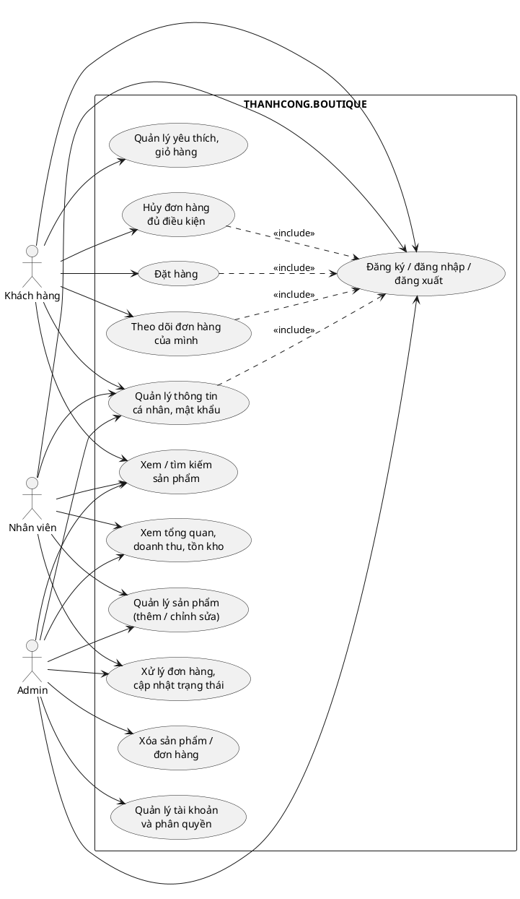

# Use Case phân quyền THANHCONG.BOUTIQUE

## 1. Mục tiêu

Mô tả quyền truy cập của ba vai trò trong website bán hàng:

- **Khách hàng (`CUSTOMER`)**: mua sắm và quản lý thông tin, đơn hàng của chính mình.
- **Nhân viên (`STAFF`)**: quản lý sản phẩm và xử lý đơn hàng.
- **Admin (`ADMIN`)**: quản trị toàn bộ chức năng, tài khoản và vai trò.

Tài khoản đăng ký mới mặc định có vai trò `CUSTOMER`. Chỉ admin được thay đổi vai trò tài khoản. Không sử dụng vai trò “quản lý” riêng trong phạm vi use case này.

## 2. Tác nhân

| Tác nhân | Mô tả |
|---|---|
| Khách hàng | Người mua hàng đã đăng ký và đăng nhập. |
| Nhân viên | Nhân sự cửa hàng được admin cấp tài khoản nhân viên. |
| Admin | Người quản trị cửa hàng, có quyền quản lý tài khoản và toàn bộ dữ liệu nghiệp vụ. |

## 3. Ma trận phân quyền

| Chức năng | Khách hàng | Nhân viên | Admin |
|---|:---:|:---:|:---:|
| Xem, tìm kiếm sản phẩm | ✓ | ✓ | ✓ |
| Đăng ký, đăng nhập, đăng xuất | ✓ | ✓ | ✓ |
| Quản lý thông tin và mật khẩu của chính mình | ✓ | ✓ | ✓ |
| Thêm sản phẩm vào yêu thích/giỏ hàng | ✓ | ✓ | ✓ |
| Đặt hàng và xem đơn hàng của chính mình | ✓ | — | — |
| Hủy đơn của chính mình khi đang chờ xác nhận/đã xác nhận | ✓ | — | — |
| Xem danh sách đơn hàng cửa hàng | — | ✓ | ✓ |
| Cập nhật trạng thái đơn hàng | — | ✓ | ✓ |
| Thêm và chỉnh sửa sản phẩm | — | ✓ | ✓ |
| Xóa sản phẩm và đơn hàng | — | — | ✓ |
| Xem tổng quan, doanh thu và cảnh báo tồn kho | — | ✓ | ✓ |
| Xem, xóa tài khoản và phân quyền người dùng | — | — | ✓ |

**Quy ước:** “—” là không được phép. Nhân viên không được tự cấp quyền hoặc thay đổi vai trò tài khoản. Admin không thể tự xóa tài khoản hoặc tự hạ quyền đang đăng nhập.

## 4. Sơ đồ Use Case

## 5. Đặc tả các Use Case chính

### UC-01 — Đặt hàng

- **Tác nhân chính:** Khách hàng.
- **Điều kiện trước:** Khách hàng đã đăng nhập; giỏ hàng có sản phẩm còn đủ tồn kho.
- **Luồng chính:**
  1. Khách hàng mở giỏ hàng và chọn tiến hành đặt hàng.
  2. Hệ thống yêu cầu họ tên, số điện thoại, địa chỉ nhận hàng và phương thức thanh toán.
  3. Khách hàng nhập thông tin và xác nhận đặt hàng.
  4. Hệ thống kiểm tra dữ liệu, tồn kho và tạo đơn ở trạng thái **Chờ xác nhận**.
  5. Hệ thống cập nhật tồn kho, xóa giỏ hàng và hiển thị đơn hàng vừa tạo.
- **Ngoại lệ:** Nếu thiếu thông tin, số điện thoại không hợp lệ, sản phẩm không còn tồn tại hoặc không đủ tồn kho, hệ thống thông báo lỗi và không tạo đơn.
- **Điều kiện sau:** Đơn hàng được gắn với tài khoản khách hàng đã đăng nhập.

### UC-02 — Nhân viên xử lý đơn hàng

- **Tác nhân chính:** Nhân viên.
- **Điều kiện trước:** Nhân viên đã đăng nhập và có quyền truy cập quản lý.
- **Luồng chính:**
  1. Nhân viên mở mục **Quản lý → Đơn hàng**.
  2. Hệ thống hiển thị các đơn hàng và thông tin nhận hàng.
  3. Nhân viên cập nhật trạng thái đơn theo tiến trình xử lý.
  4. Hệ thống lưu trạng thái mới để khách hàng theo dõi.
- **Ngoại lệ:** Người dùng không có vai trò nhân viên hoặc admin bị từ chối truy cập chức năng.
- **Điều kiện sau:** Trạng thái đơn hàng được cập nhật; nhân viên không thể xóa đơn hàng.

### UC-03 — Admin quản lý tài khoản và phân quyền

- **Tác nhân chính:** Admin.
- **Điều kiện trước:** Admin đã đăng nhập.
- **Luồng chính:**
  1. Admin mở mục **Quản lý → Tài khoản**.
  2. Hệ thống hiển thị danh sách tài khoản và vai trò hiện tại.
  3. Admin chọn tài khoản và gán một trong các vai trò **Khách hàng**, **Nhân viên**, **Admin** hoặc xóa tài khoản.
  4. Hệ thống lưu thay đổi và áp dụng quyền tương ứng cho tài khoản.
- **Ngoại lệ:** Không cho phép admin tự xóa tài khoản hoặc tự thay đổi vai trò của chính mình.
- **Điều kiện sau:** Vai trò tài khoản được cập nhật; tài khoản bị xóa không thể tiếp tục sử dụng hệ thống.

## 6. Quy tắc phân quyền

1. Mỗi tài khoản chỉ có một vai trò: `CUSTOMER`, `STAFF` hoặc `ADMIN`.
2. Vai trò mặc định khi đăng ký là `CUSTOMER`; người dùng không được tự chọn `STAFF` hoặc `ADMIN` khi đăng ký.
3. Chức năng quản lý chỉ dành cho `STAFF` và `ADMIN`; quản lý tài khoản, xóa dữ liệu và phân quyền chỉ dành cho `ADMIN`.
4. Khách hàng chỉ được xem, hủy các đơn hàng thuộc tài khoản của mình. Chỉ được hủy khi đơn ở trạng thái **Chờ xác nhận** hoặc **Đã xác nhận**.
5. Các quyền cần được kiểm tra khi thực hiện thao tác, không chỉ ẩn nút hoặc menu trên giao diện.
